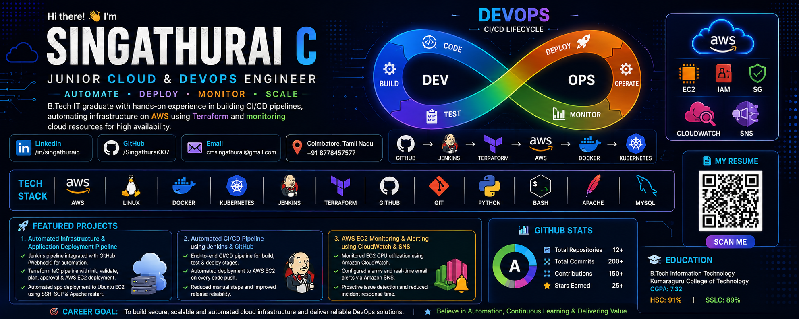

<div align="center">


<h1>Hi 👋, I'm Singathurai C</h1>

<h3>Software &nbsp;·&nbsp; Cloud &nbsp;·&nbsp; DevOps Engineer</h3>

<a href="https://github.com/Singathurai007">
  
</a>

<p>
  <b>JavaScript • React • Node.js • Java • AWS • Terraform • Jenkins • Docker • Kubernetes • Linux • Prometheus</b>
</p>

<p>
  <b>35 public repositories</b> &nbsp;•&nbsp; <b>190+ contributions</b> in the last year &nbsp;•&nbsp; Open to Software · Cloud · DevOps roles
</p>

<p>
  <a href="https://www.linkedin.com/in/singathuraic">
    
  </a>
  <a href="https://github.com/Singathurai007">
    
  </a>
  <a href="https://github.com/Singathurai007/singathurai-portfolio">
    
  </a>
  <a href="./Singathurai_C_Resume_MHTECHIN_JuniorCloudDevOps.pdf">
    
  </a>
</p>

</div>

---

## 👨‍💻 Professional Summary



Software, Cloud and DevOps Engineer with a **B.Tech in Information Technology**, specialising in building, automating and operating reliable systems.

- 💼 **Role:** Software · Cloud · DevOps Engineer — I design, automate and ship systems that stay up.
- 🎓 **Education:** B.Tech Information Technology, focused on Cloud & DevOps.
- 🛠️ **Hands-on:** CI/CD pipelines, AWS infrastructure as code with Terraform, and application deployments to Ubuntu EC2 via Jenkins, SSH & SCP.
- ☁️ **Passionate about:** automation, cloud infrastructure, deployment reliability and monitoring.
- 🚀 **Currently levelling up in:** Advanced Kubernetes, GitOps, DevSecOps and Cloud Architecture.
- 🤝 **Strengths:** automation-first mindset, debugging, documentation and continuous learning.
- 📫 **Reach me:** [LinkedIn](https://www.linkedin.com/in/singathuraic) · [Portfolio](https://github.com/Singathurai007/singathurai-portfolio) · [Resume](./Singathurai_C_Resume_MHTECHIN_JuniorCloudDevOps.pdf)

<br clear="both" />

---

## 🛠️ Technical Skills

### 💻 Software Engineering
`JavaScript` `TypeScript` `Java` `Python` `React` `Next.js` `Node.js` `Express` `HTML5` `CSS3` `Bootstrap` `Tailwind CSS` `REST API` `MySQL` `PostgreSQL` `MongoDB` `Git` `Jest` `npm` `VS Code` `Postman`

### ☁️ Cloud Engineering
`AWS` `EC2` `IAM` `S3` `CloudWatch` `SNS` `Terraform` `Linux` `Ubuntu` `Apache` `Nginx`

### ⚙️ DevOps Engineering
`Jenkins` `GitHub Actions` `GitLab CI` `ArgoCD` `Terraform` `Ansible` `Helm` `Vagrant` `Docker` `Kubernetes` `Prometheus` `Grafana` `ELK` `Bash` `SonarQube` `Trivy` `Vault` `Nexus`

---

## 🚀 Featured Projects

### 1. Automated Infrastructure & Application Deployment Pipeline
`Jenkins` `GitHub` `Terraform` `AWS EC2` `Apache`

```text
GitHub → Jenkins → Terraform → AWS EC2 → SSH / SCP → Apache → Application Deployment
```

- Integrated GitHub with Jenkins to trigger the pipeline on every push.
- Provisioned AWS infrastructure as code with Terraform, running `init → validate → plan → apply`.
- Added a **manual approval gate** before infrastructure deployment.
- Automated application delivery to Ubuntu EC2 over **SSH / SCP** and restarted Apache after each deployment.

### 2. Automated CI/CD Pipeline using Jenkins & GitHub
`GitHub Webhooks` `Jenkins` `AWS EC2`

```text
Developer → GitHub → Webhook → Jenkins → Build → Test → Deploy → AWS EC2
```

- Configured **GitHub webhooks** so Jenkins builds automatically after every code push.
- Implemented separate **build, test and deployment** stages.
- Reduced manual deployment effort and shortened release lead time.

### 3. AWS EC2 Monitoring & Alerting
`CloudWatch` `SNS` `EC2`

```text
AWS EC2 → CloudWatch → CPU Alarm → SNS → Email Alert
```

- Monitored EC2 instance health and CPU utilisation.
- Configured **CloudWatch alarms** with **Amazon SNS** email notifications.
- Improved infrastructure issue awareness and response time.

---

## 📌 Popular Repositories

| Repository | Description | Tech |
| :--- | :--- | :--- |
|  **[DevSecOps + GitOps delivery pipeline](https://github.com/singathurai007/devsecops-gitops.git)** | using Jenkins, Docker, Trivy, SonarQube, Docker Hub, GitHub, ArgoCD, and Kubernetes.|`devsec-ops`|
| 📖 **[book-sky](https://github.com/Singathurai007/book-sky)** | Create your own book | `HTML` |
| 🎨 **[nostra](https://github.com/Singathurai007/nostra)** | Frontend project | `HTML` |
| 🎨 **[MyProject](https://github.com/Singathurai007/MyProject)** | Frontend project | `HTML` |
| 🎨 **[rgkfc](https://github.com/Singathurai007/rgkfc)** | Frontend project | `Frontend` |
| ⚙️ **[html](https://github.com/Singathurai007/html)** | Practice repository for CI/CD pipeline | `HTML` |

---

## 📚 Currently Learning

`Advanced Kubernetes` `AWS Cloud Architecture` `DevSecOps` `GitOps` `Infrastructure as Code` `Cloud Monitoring`

---

## 🎯 Career Objective

To build **secure, scalable and automated cloud infrastructure**, and contribute to reliable DevOps solutions through automation, continuous learning and cloud-native technologies.

---

## 📈 DevOps Journey

```text
GitHub → Jenkins → CI/CD → Terraform → AWS → Docker → Kubernetes → Monitoring
```

---


---

## 🤝 Connect

<div align="center">

<a href="https://www.linkedin.com/in/singathuraic">
  
</a>
<a href="https://github.com/Singathurai007">
  
</a>
<a href="https://github.com/Singathurai007/singathurai-portfolio">
  
</a>
<a href="./Singathurai_C_Resume_MHTECHIN_JuniorCloudDevOps.pdf">
  
</a>

<br /><br />

<p><b>🚀 Automate • Deploy • Monitor • Improve 🚀</b></p>


</div>
