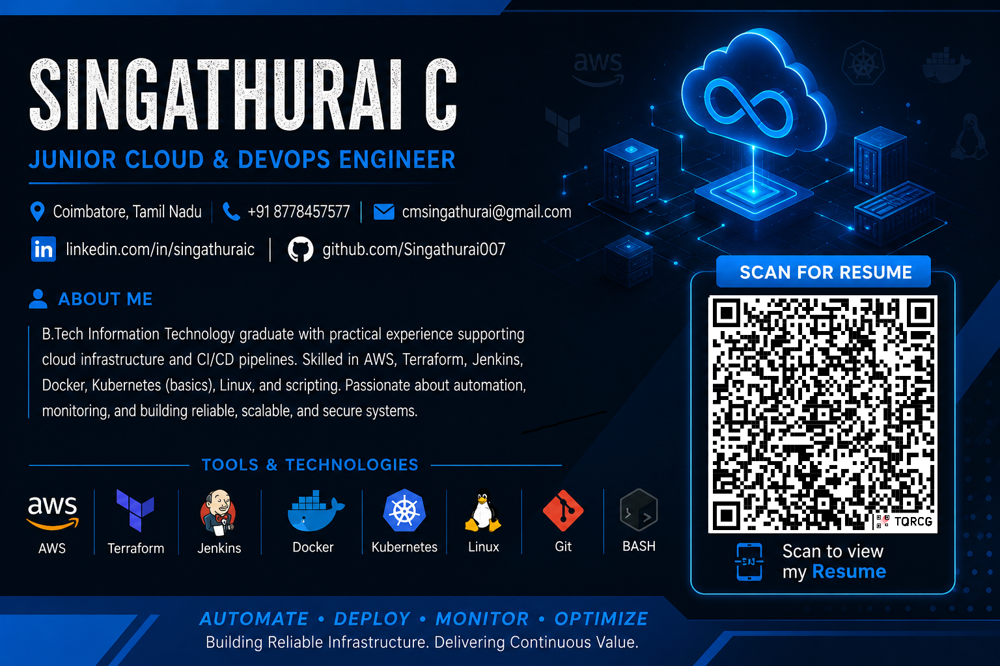

<div align="center">

<p align="center">
  
</p>

<h1 align="center">Hi 👋, I'm Singathurai C</h1>

<h3 align="center">Software&nbsp;||&nbsp;Cloud&nbsp;||&nbsp;DevOps Engineer</h3>

<a href="https://github.com/Singathurai007">
  
</a>

<p align="center">
  <b>JavaScript • React • Node.js • Java • AWS • Terraform • Jenkins • Docker • Kubernetes • Linux • Prometheus</b>
</p>

<p align="center">
  <a href="https://www.linkedin.com/in/singathuraic">
    
  </a>
  <a href="https://github.com/Singathurai007">
    
  </a>
  <a href="./Singathurai_C_Resume_MHTECHIN_JuniorCloudDevOps.pdf">
    
  </a>
</p>

</div>

---

## 👨‍💻 About Me


- 💼 **Software | Cloud | DevOps Engineer** — I build, automate and ship reliable systems.
- 🎓 B.Tech **Information Technology** graduate focused on **Cloud & DevOps**.
- 🛠️ Hands-on with **CI/CD pipelines**, **AWS infrastructure as code (Terraform)** and app deployments to **Ubuntu EC2** via Jenkins, SSH & SCP.
- ☁️ Passionate about **automation, cloud infrastructure, deployment reliability & monitoring**.
- 🚀 Currently leveling up in **Advanced Kubernetes, GitOps, DevSecOps & Cloud Architecture**.
- 📫 Reach me on **[LinkedIn](https://www.linkedin.com/in/singathuraic)** • 📄 **[Resume](./Singathurai_C_Resume_MHTECHIN_JuniorCloudDevOps.pdf)**

<br clear="both" />

---

## 🛠️ Tech Stack

| Category | Skills |
| :--- | :--- |
| **Languages** | JavaScript, TypeScript, Java, Python, Bash |
| **Frontend** | React, Next.js, HTML5, CSS3, Bootstrap, Tailwind CSS |
| **Backend & APIs** | Node.js, Express, REST API, Jest, npm |
| **Databases** | MySQL, PostgreSQL, MongoDB, Redis |
| **Cloud (AWS)** | EC2, IAM, S3, CloudWatch, SNS |
| **CI/CD & Automation** | Jenkins, GitHub Actions, GitLab CI, ArgoCD |
| **Infrastructure as Code** | Terraform, Ansible, Helm, Vagrant |
| **Containers & Orchestration** | Docker, Kubernetes |
| **Operating Systems** | Linux, Ubuntu |
| **Monitoring & Logging** | Prometheus, Grafana, CloudWatch, ELK |
| **DevSecOps & Quality** | SonarQube, Trivy, Vault, Nexus |
| **Web Servers & Tools** | Apache, Nginx, Git, GitHub, VS Code, Postman |

---

##  Contribution Snake

<div align="center">


</div>

---

## 🚀 Featured Projects

### 1️⃣ Automated Infrastructure & Application Deployment Pipeline
`Jenkins + GitHub + Terraform + AWS + EC2`

```text
GitHub → Jenkins → Terraform → AWS EC2 → SSH / SCP → Apache → Application Deployment
```

- Integrated GitHub with Jenkins to trigger CI/CD pipelines.
- Automated AWS infrastructure provisioning using Terraform.
- Implemented `terraform init / validate / plan / apply` stages.
- Added **manual approval** before infrastructure deployment.
- Automated application deployment to Ubuntu EC2 using SSH and SCP.
- Restarted Apache automatically after deployment.

### 2️⃣ Automated CI/CD Pipeline using Jenkins & GitHub
`GitHub Webhooks + Jenkins + AWS EC2`

```text
Developer → GitHub → Webhook → Jenkins → Build → Test → Deploy → AWS EC2
```

- Configured GitHub webhooks with Jenkins.
- Automated builds and deployments after every code push.
- Implemented build, test and deployment stages.
- Reduced manual deployment activities.

### 3️⃣ AWS EC2 Monitoring & Alerting
`CloudWatch + SNS + EC2`

```text
AWS EC2 → CloudWatch → CPU Alarm → SNS → Email Alert
```

- Monitored EC2 instance health and CPU utilization.
- Configured CloudWatch alarms.
- Integrated Amazon SNS for email notifications.
- Improved infrastructure issue awareness and response time.

---

## 📚 Currently Learning

<p>
  
  
  
  
  
  
</p>

---

## 🎯 Career Goal

To build **secure, scalable and automated cloud infrastructure** and contribute to reliable DevOps solutions through automation, continuous learning and cloud-native technologies.

---

## 📈 DevOps Journey

```text
GitHub → Jenkins → CI/CD → Terraform → AWS → Docker → Kubernetes → Monitoring
```

---

<div align="center">

<p><b>🚀 Automate • Deploy • Monitor • Improve 🚀</b></p>


</div>
